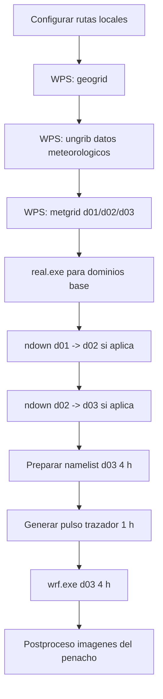

# Flujo general de ejecucion

## Orden recomendado

1. Revisar entorno Linux y rutas.
2. Crear arbol de trabajo para el caso.
3. Preparar `namelist.wps` para tres dominios.
4. Ejecutar WPS completo.
5. Validar `geo_em` y `met_em`.
6. Preparar `namelist.input` meteorologico y correr `real.exe`.
7. Ejecutar `ndown.exe` para transferir condiciones a dominios finos si se
   usa anidamiento one-way.
8. Preparar corrida corta de `d03` con trazador.
9. Generar el pulso de 1 hora.
10. Correr `wrf.exe`.
11. Verificar que `wrfout_d03_*` contiene el trazador.
12. Generar imagenes, GIF o paneles de diagnostico.

## Validaciones minimas

- `geo_em.d01.nc`, `geo_em.d02.nc`, `geo_em.d03.nc` existen.
- `met_em.d01.*`, `met_em.d02.*`, `met_em.d03.*` cubren la ventana temporal.
- `real.exe` termina con `SUCCESS COMPLETE REAL_EM INIT`.
- `ndown.exe` termina sin errores y genera archivos esperados para el dominio
  hijo.
- `wrf.exe` termina con `SUCCESS COMPLETE WRF`.
- El `wrfout_d03_*` contiene la variable de trazador esperada.
